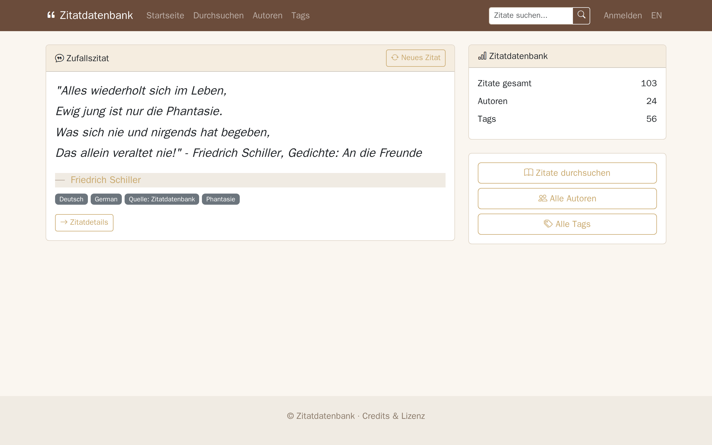
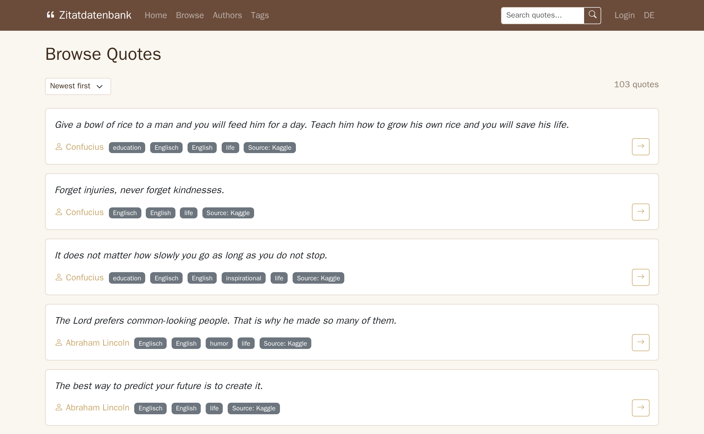
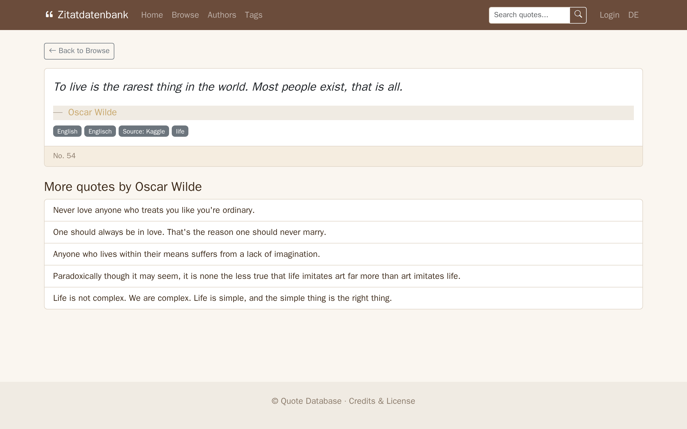
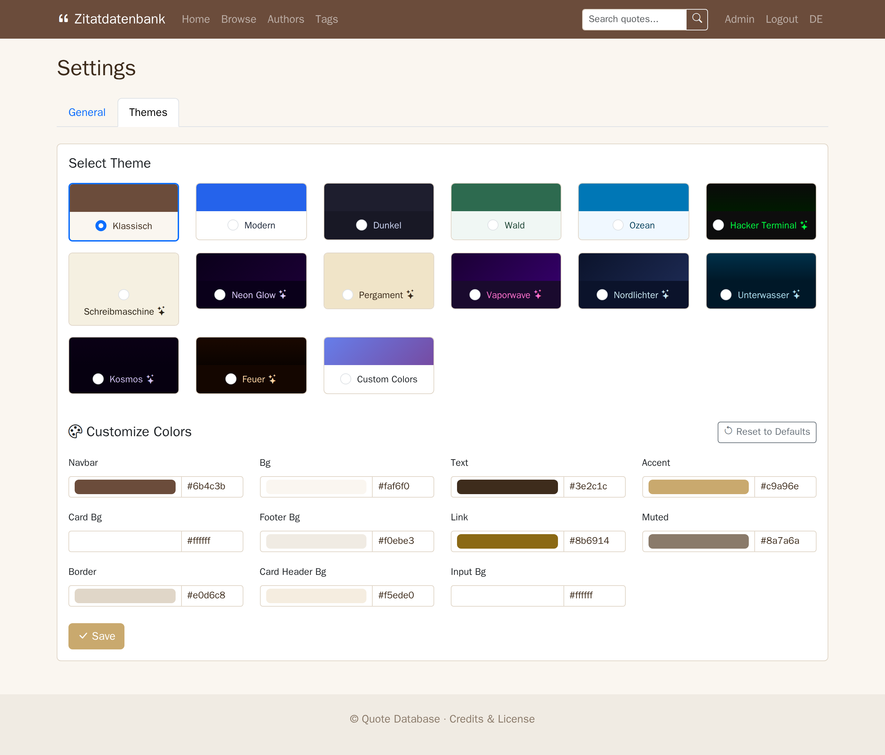
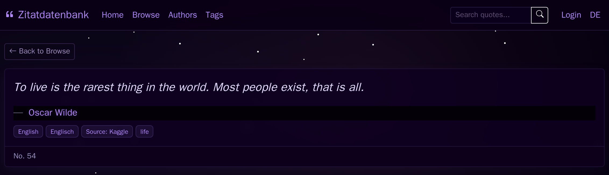
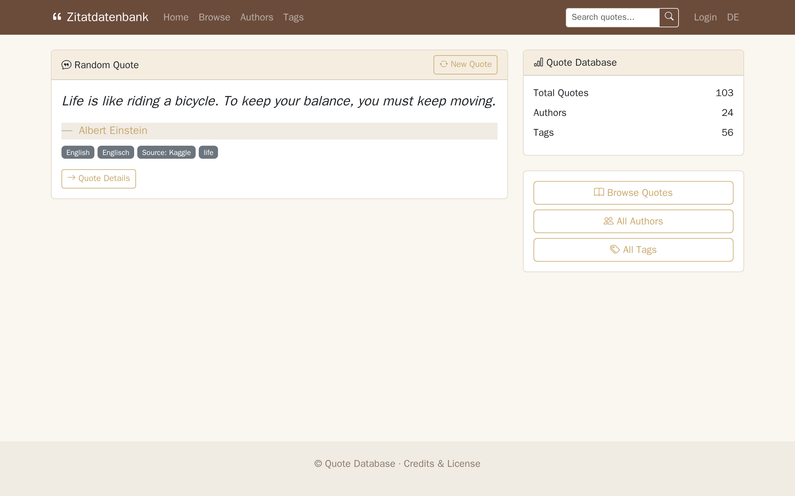

# Zitatdatenbank

Eine zweisprachige (DE/EN) Webanwendung zum Durchsuchen, Suchen und Verwalten von ~517.000 Zitaten (24.600 deutsche + 493.000 englische), selbst gehostet als Docker-Stack (Flask + MariaDB).



**Status:** aktiv gepflegt. CI prüft jeden Push mit den Tests, `pip-audit`, der Screenshot-Tour (als Render-Check) und der E2E-Suite.

<p>
  
  
  
  
</p>

Alle Seiten und alle 14 Themes: [Screenshot-Galerie](docs/screenshots/README.md) (englische Oberfläche, die Startseite auch auf Deutsch).

**Inhalt:** [Schnellstart](#schnellstart-mit-docker) · [Funktionen](#funktionen) · [Themes](#themes) · [API](#api) · [Performance](#performance) · [Sicherheit](#sicherheit) · [Konfiguration](#konfiguration) · [Entwicklung](#entwicklung) · [CLI](#cli-befehle) · [Screenshots](#screenshots) · [Daten & Lizenzen](#daten--lizenzen) · **[English](#zitatdatenbank-english)**

---

## Schnellstart mit Docker

Voraussetzung: [Git LFS](https://git-lfs.com). `data/data.tar.gz` liegt in Git LFS; ohne git-lfs enthält der Klon nur eine kleine Pointer-Datei, und der `web`-Container bricht beim Start mit einem entsprechenden Hinweis ab.

```bash
git lfs install && git lfs pull   # einmalig nach dem Klonen: holt data/data.tar.gz (~53 MB)
cp .env.example .env
# .env mit eigenen Werten bearbeiten (SECRET_KEY, Passwörter)

docker compose up -d
```

- **Aufruf:** `http://localhost:5000` (Port über `WEB_PORT`), das Admin-Panel unter `/admin`.
- **Erster Start:** entpackt `data/data.tar.gz`, importiert ~24.600 deutsche Zitate aus `zitate.sql` und ~500.000 englische aus `quotes.csv` und legt den Admin-Benutzer aus den Umgebungsvariablen an. Den Fortschritt (Schritte [1/6]–[6/6]) zeigt `docker compose logs -f web`.
- **Versionierte Datenbereinigung** nach dem Import, danach bleiben ~517.000 Zitate:
  - Wiki-Markup
  - abgeschnittene Autoren
  - nicht-lateinische Schriftzeichen
  - Duplikate (Deduplizierung via CRC32-indiziertem Hashing)
- **HTTPS:** Session-Cookies sind `Secure`. Über reines HTTP funktionieren Anmeldung, Formulare (CSRF) und Sprachwechsel nur unter `http://localhost`; auf einem Server die App hinter einen HTTPS-Reverse-Proxy stellen.
- **MariaDB-Upgrade bestehender Installationen:** Der `db`-Service setzt `MARIADB_AUTO_UPGRADE=1`, daher wird `mariadb-data/` beim ersten Start mit einer neueren Major-Version automatisch aktualisiert.
  - Vorher einen geprüften Dump anlegen (`docker compose exec db mariadb-dump ...`): Ein Major-Upgrade lässt sich nicht zurückrollen.

### Admin-Zugang

- **Zugangsdaten:** `ADMIN_USERNAME` (Standard `admin`) und `ADMIN_PASSWORD`; ohne `ADMIN_PASSWORD`, `DB_PASSWORD` oder `DB_ROOT_PASSWORD` in `.env` bricht `docker compose` mit einer Meldung ab.
- **Bestehende Installationen ohne diese Werte** liefen mit den früheren Standards: `DB_ROOT_PASSWORD=rootchangeme` und `DB_PASSWORD=zitate` in `.env` eintragen (MariaDB übernimmt neue Passwörter nicht in ein bestehendes `mariadb-data/`).
- **Nur beim ersten Anlegen:** Ein späteres Ändern von `ADMIN_PASSWORD` ändert das Passwort nicht. Dafür `flask create-admin --username <name> --password <neu>`.

## Funktionen

### Öffentliche Seiten

- **Zufallszitat** auf der Startseite; **Neues Zitat** holt ein anderes.
- **Durchsuchen** von Zitaten mit Paginierung, Filterung nach Autor/Tag und Sortierung.
- **Volltextsuche** in Zitaten, Autoren und Tags.
- **Autorenliste** mit Zitatanzahl und A–Z-Navigation.
- **Tag-Liste** nach Zitatanzahl sortiert, bei Gleichstand alphabetisch.
- **Zitatdetail** mit Tags und weiteren Zitaten desselben Autors.
- **Zeilenumbruch-Darstellung:** `//` im Zitattext wird als Zeilenumbruch angezeigt.
- **Zweisprachig:** Deutsch/Englisch-Oberfläche mit Ein-Klick-Sprachwechsel (`DE` / `EN`), Standard Deutsch.
- **Responsiv:** Auf schmalen Bildschirmen klappt die Navigation in den Menü-Button.
- **Credits & Lizenz** (`/credits`): Datenquellen und ihre Lizenzen.
- **REST-API** für Zitate mit Filterung, Suche und Paginierung, siehe [API](#api).

### Admin-Panel

- **Admin-Dashboard** mit Statistik und den 10 neuesten Zitaten.
- **Zitate verwalten:** anlegen, bearbeiten, löschen, suchen.
- **Tags verwalten:** anlegen und löschen.
- **Einstellungen → Allgemein:** Seitenname und Zitate pro Seite (5–100).
- **Einstellungen → Themen:** Theme wählen, Farben und Effekte pro Theme anpassen, **Zurücksetzen** auf die Standardwerte.
- **Backup:** Datenbank-Dump als `.tar.gz` in `./backups` erstellen, herunterladen, wiederherstellen oder löschen; das Protokoll zeigt die letzten 20 Einträge.
- **Rückfragen** vor dem Löschen und Wiederherstellen („Wirklich löschen?“).

## Themes

14 Themes, dazu „Eigene Farben“ (frei wählbare Farben auf Basis von Klassisch). Pro Theme sind in den Admin-Einstellungen alle 11 Farben und 2 Effektwerte (Tippgeschwindigkeit, Partikelanzahl) einstellbar.

| Statisch | Animiert |
|----------|----------|
| Klassisch | Hacker Terminal |
| Modern | Schreibmaschine |
| Dunkel | Neon Glow |
| Wald | Pergament |
| Ozean | Vaporwave |
| | Nordlichter |
| | Unterwasser |
| | Kosmos |
| | Feuer |

- **Tipp-Animation:** Animierte Themes tippen das Zitat, mit eigenem Cursor je Theme und einstellbarer Geschwindigkeit.
- **Partikeleffekte:** Blasen (Unterwasser), Sterne (Kosmos) und Funken (Feuer), Anzahl einstellbar.
- **Reduzierte Bewegung:** Bei `prefers-reduced-motion` stehen die Animationen still und das Zitat erscheint sofort.

## API

Alle Endpunkte liefern JSON. Rate-Limit-Header (`X-RateLimit-Limit`, `X-RateLimit-Remaining`, `X-RateLimit-Reset`) sind in jeder Antwort enthalten.

| Endpunkt | Liefert | Limit |
|----------|---------|-------|
| `GET /api/random` | ein zufälliges Zitat | 30/Min. |
| `GET /api/quotes` | Zitate durchsuchen und suchen, mit Paginierung | 30/Min. |
| `GET /api/quotes/<id>` | ein einzelnes Zitat nach ID | 60/Min. |
| `GET /health` | Healthcheck: `200 {"status": "ok", "checks": {"database": "ok"}}`, bei Datenbankfehler `503` | keins |

Ein Zitat (`/api/random`, `/api/quotes/<id>`):

```json
{"id": 42, "text": "Der einzige Weg...", "author": "Albert Einstein", "tags": ["Deutsch", "Philosophie"]}
```

Parameter von `/api/quotes`:

| Parameter | Beschreibung | Standard |
|-----------|-------------|----------|
| `page` | Seitennummer | 1 |
| `per_page` | Ergebnisse pro Seite (1–100) | 20 |
| `author` | Nach exaktem Autorennamen filtern | — |
| `tag` | Nach Tag-Name filtern | — |
| `q` | Volltextsuche in Text und Autor | — |

```json
{"quotes": [...], "page": 1, "per_page": 20, "has_next": true, "has_prev": false}
```

## Performance

Optimiert für 500.000+ Zitate:

- **Keyset-Paginierung (cursorbasiert):** Seiten laden in konstanter Zeit, egal wie tief (Seite 26100 = 25ms, wie Seite 1).
- **In-Memory-Cache** (5 Min. TTL), eliminiert 15+ DB-Abfragen pro Request:
  - Statistiken
  - Theme
  - Tags
  - Einstellungen
- **FastPagination:** überspringt teure COUNT-Abfragen mit N+1-Fetch.
- **FULLTEXT-Indizes** auf Text- und Autorspalten (MariaDB).
- **selectinload** für Tags: bündelt N+1 Tag-Abfragen in eine einzige IN-Abfrage.
- **Gecachte Tag-Name→ID-Map:** Die Suche findet passende Tags in Mikrosekunden statt per SQL-ILIKE-Scan.

| Route | Antwortzeit |
|-------|-------------|
| Startseite | 7ms |
| Durchsuchen | 87ms |
| Durchsuchen tief (Seite 25000+) | 25ms |
| Autoren | 20ms |
| Tags | 3ms |
| Suche | 33–100ms |
| Zitatdetail | 16ms |

## Sicherheit

- **CSP** mit Nonce-basierter script-src, `frame-ancestors 'none'`, `object-src 'none'`
- **X-Frame-Options: DENY**, **X-Content-Type-Options: nosniff**
- **CSRF**-Schutz auf allen Formularen (Flask-WTF); ein abgelaufenes Formular kommt mit einer Meldung zurück, statt mit einer nackten 400-Seite
- **Rate-Limiting** bei Login (10/Min.), Suche (30/Min.) und API-Endpunkten (30–60/Min.) mit `X-RateLimit-*`-Headern
- **Session-Sicherheit:** HttpOnly, SameSite=Lax, Secure-Cookies, 8h Timeout
- **Eingabevalidierung:**
  - numerische Grenzen und Seitenzahl-Begrenzung
  - Hex-Farb-Regex für alle Theme-Overrides, Effektwert-Validierung
  - Dateinamen-Whitelist für Backups
  - FULLTEXT-Operator-Bereinigung, LIKE-Wildcard-Escaping
- **Open-Redirect-Schutz:** Weiterleitungen nach Login (`next`), Sprachwechsel und Fehlermeldungen führen nur auf Seiten dieser Site; Tricks wie `/\x` oder `///x` werden abgewiesen
- **Fehlerseite ohne Datenbank:** Ist die Datenbank weg, kommt trotzdem die übersetzte Fehlerseite
- **Sichere Backups:** schließt App-State-Tabellen aus, Tar lehnt Symlinks ab, Restore setzt Cleanup-/Migrationsstatus zurück
- **Datenintegrität:** `ON DELETE CASCADE` auf Foreign Keys, Savepoint-basierte `IntegrityError`-Behandlung bei gleichzeitigen Schreibvorgängen
- **Transaktionssicherheit:** `begin_nested()`-Savepoints verhindern, dass Tag-Race-Conditions umgebende Transaktionen zurückrollen

## Konfiguration

Alle Werte stehen in `.env.example`; `docker-compose.yml` reicht sie an die Container weiter.

| Variable | Zweck | Standard |
|----------|-------|----------|
| `SECRET_KEY` | Flask-Schlüssel; ohne Wert oder mit dem Beispielwert startet die App nicht | — |
| `DB_ROOT_PASSWORD` | MariaDB-Root-Passwort | — (Pflicht) |
| `DB_NAME`, `DB_USER`, `DB_PASSWORD` | Datenbank und ihr Benutzer | `zitatdatenbank`, `zitate`, — (Pflicht) |
| `WEB_PORT` | Host-Port der App | `5000` |
| `ADMIN_USERNAME`, `ADMIN_PASSWORD` | Admin beim ersten Start | `admin`, — (Pflicht) |
| `LOG_LEVEL` | Log-Level | `INFO` |

Technik: Python 3.15 (Image `python:3.15.2-slim-trixie`), Flask 3.1 mit SQLAlchemy, gunicorn, MariaDB 12.3, Bootstrap 5.3 und Bootstrap Icons (selbst gehostet).

## Entwicklung

```bash
pip install -r requirements.txt

# Tests ausführen
python3 -m pytest

# Lokal starten (SQLite unter instance/dev.db, Admin admin/admin)
cd app
export SECRET_KEY=dev-secret SQLALCHEMY_DATABASE_URI=sqlite:///dev.db
flask create-admin --username admin --password admin   # legt auch die Tabellen an
flask import-csv ../e2e/docs/fixtures/quotes-en.csv --default-tags "English,Englisch,Source: Kaggle"
flask run      # http://localhost:5000
```

`flask`-Befehle (auch `flask run`) legen nur die Tabellen an. Die Startsequenz läuft nur im Server (gunicorn im Docker-Image):

- Admin aus `ADMIN_PASSWORD`
- Auto-Import aus `/data`
- Bereinigung
- Tag-Migration
- Suchindizes

### E2E-Tests

Die Playwright-Suite in `e2e/tests/` prüft jede Seite und jede Funktion im Browser gegen einen Wegwerf-Stack aus dem Produktions-Image (MariaDB, Compose-Projekt `zitatdatenbank_e2e`, nur `127.0.0.1:${PORT_BASE:-25600}`). Die Abdeckungsliste steht in [`e2e/COVERAGE.md`](e2e/COVERAGE.md).

```bash
cd e2e && npm ci && npx playwright install chromium && cd ..
scripts/e2e.sh                      # ganze Suite, Stack wird danach abgebaut
scripts/e2e.sh --grep backup        # Playwright-Argumente werden durchgereicht
```

## CLI-Befehle

Im Ordner `app/` mit `flask …`, im Docker-Stack mit `docker compose exec web flask …`:

- `flask import-quotes <pfad>`: Zitate aus SQL-Dump importieren
- `flask import-csv <pfad> --default-tags "tag1,tag2"`: Zitate aus CSV importieren (Spalten: quote, author, category)
- `flask cleanup-quotes`: Wiki-Markup, abgeschnittene Autoren/Kategorien, nicht-lateinische Schriftzeichen und Duplikate bereinigen
- `flask create-admin --username X --password Y`: Admin-Benutzer erstellen oder sein Passwort neu setzen

## Screenshots

Die Bilder erzeugt die Screenshot-Tour (`e2e/docs/`, Playwright):

```bash
cd e2e && npm ci && npx playwright install chromium && cd ..
scripts/docs-screenshots.sh                  # schreibt docs/screenshots/*.png
PORT_BASE=25600 scripts/docs-screenshots.sh /tmp/shots   # anderer Port / Zielordner
```

- **Stack:** baut das Image und startet einen Wegwerf-Stack (Compose-Projekt `zitatdatenbank_docs`, nur `127.0.0.1:${PORT_BASE:-25600}`, ohne Bind-Mounts, also ohne `data/data.tar.gz`).
- **Ablauf:** importiert ~100 Beispielzitate aus `e2e/docs/fixtures/` und fotografiert jede Seite.
- **Auf GitHub** liefert der Workflow **Docs screenshots** (Actions, manuell) dieselben Bilder als Artefakt.

## Daten & Lizenzen

- **Deutsch:** ~24.600 Zitate aus der [Zitatdatenbank von datenbörse.net](https://www.datenbörse.net/item/Zitatdatenbank), Lizenz [CC BY-SA 3.0](https://creativecommons.org/licenses/by-sa/3.0/).
- **Englisch:** ~500.000 Zitate aus [Quotes 500K (Kaggle)](https://www.kaggle.com/datasets/manann/quotes-500k), Lizenz [CC0 1.0](https://creativecommons.org/publicdomain/zero/1.0/).
- Die Seite **Credits & Lizenz** (`/credits`) der App nennt beide Quellen samt Lizenztext.

---

# Zitatdatenbank (English)

A bilingual (DE/EN) web application for browsing, searching, and managing ~517,000 quotes (24.6k German + 493k English), self-hosted as a Docker stack (Flask + MariaDB).



**Status:** actively maintained. CI checks every push with the tests, `pip-audit`, the screenshot tour (as a render check) and the E2E suite.

<p>
  
  
  
  
</p>

Every page and all 14 themes: [screenshot gallery](docs/screenshots/README.md).

**Contents:** [Quick Start](#quick-start-with-docker) · [Features](#features) · [Themes](#themes-1) · [API](#api-1) · [Performance](#performance-1) · [Security](#security) · [Configuration](#configuration) · [Development](#development) · [CLI](#cli-commands) · [Screenshots](#screenshots-1) · [Data & Licences](#data--licences) · **[Deutsch](#zitatdatenbank)**

## Quick Start with Docker

Requires [Git LFS](https://git-lfs.com): `data/data.tar.gz` is stored in Git LFS. Without git-lfs the clone only contains a small pointer file, and the `web` container exits on startup with a message saying so.

```bash
git lfs install && git lfs pull   # once after cloning: fetches data/data.tar.gz (~53 MB)
cp .env.example .env
# Edit .env with your values (SECRET_KEY, passwords)

docker compose up -d
```

- **Open** `http://localhost:5000` (port via `WEB_PORT`); the admin panel is at `/admin`.
- **First start:** extracts `data/data.tar.gz`, imports ~24.6k German quotes from `zitate.sql` and ~500k English quotes from `quotes.csv`, and creates the admin user from environment variables. `docker compose logs -f web` shows the progress (steps [1/6]–[6/6]).
- **Versioned data cleanup** after the import, which leaves ~517k quotes:
  - wiki markup
  - truncated authors
  - non-Latin scripts
  - duplicates (deduplication via CRC32-indexed hashing)
- **HTTPS:** session cookies are `Secure`. Over plain HTTP, login, forms (CSRF) and the language switch only work on `http://localhost`; on a server, put the app behind an HTTPS reverse proxy.
- **Upgrading an existing install to a newer MariaDB major:** the `db` service sets `MARIADB_AUTO_UPGRADE=1`, so the container upgrades `mariadb-data/` in place on its first start.
  - Take a verified dump first (`docker compose exec db mariadb-dump ...`): a major-version upgrade cannot be rolled back.

### Admin Access

- **Credentials:** `ADMIN_USERNAME` (default `admin`) and `ADMIN_PASSWORD`; without `ADMIN_PASSWORD`, `DB_PASSWORD` or `DB_ROOT_PASSWORD` in `.env`, `docker compose` stops with a message.
- **Existing installs without these values** ran on the old defaults: put `DB_ROOT_PASSWORD=rootchangeme` and `DB_PASSWORD=zitate` in `.env` (MariaDB does not apply new passwords to an existing `mariadb-data/`).
- **Only on first creation:** changing `ADMIN_PASSWORD` later does not change the password. Use `flask create-admin --username <name> --password <new>`.

## Features

### Public pages

- **Random quote** on the landing page; **New Quote** picks another.
- **Browse** quotes with pagination, filtering by author/tag, and sorting.
- **Search** full-text across quotes, authors, and tags.
- **Author list** with quote counts and A–Z navigation.
- **Tag list** sorted by quote count, ties alphabetically.
- **Quote detail** with tags and more quotes by the same author.
- **Line break rendering:** `//` in quote text is displayed as a line break.
- **Bilingual:** German/English UI with one-click language switching (`DE` / `EN`), German by default.
- **Responsive:** on narrow screens the navigation folds into the menu button.
- **Credits & License** (`/credits`): data sources and their licences.
- **REST API** for quotes with filtering, search, and pagination, see [API](#api-1).

### Admin panel

- **Admin Dashboard** with statistics and the 10 newest quotes.
- **Manage Quotes:** add, edit, delete, search.
- **Manage Tags:** add and delete.
- **Settings → General:** site name and quotes per page (5–100).
- **Settings → Themes:** pick a theme, customize its colors and effects, **Reset to Defaults**.
- **Backup:** create a database dump as `.tar.gz` in `./backups`, download, restore or delete it; the log shows the last 20 entries.
- **Confirmations** before deleting and restoring ("Really delete?").

## Themes

14 themes, plus "Custom Colors" (free colors on top of Klassisch). All 11 colors and 2 effect values (typing speed, particle count) are editable per theme in the admin settings.

| Static | Animated |
|--------|----------|
| Klassisch | Hacker Terminal |
| Modern | Schreibmaschine |
| Dunkel | Neon Glow |
| Wald | Pergament |
| Ozean | Vaporwave |
| | Nordlichter |
| | Unterwasser |
| | Kosmos |
| | Feuer |

- **Typing animation:** animated themes type out the quote, with a cursor style per theme and configurable speed.
- **Particle effects:** bubbles (Unterwasser), stars (Kosmos) and embers (Feuer), with configurable count.
- **Reduced motion:** with `prefers-reduced-motion` the animations stop and the quote appears at once.

## API

All endpoints return JSON. Rate limit headers (`X-RateLimit-Limit`, `X-RateLimit-Remaining`, `X-RateLimit-Reset`) are included in every response.

| Endpoint | Returns | Limit |
|----------|---------|-------|
| `GET /api/random` | a random quote | 30/min |
| `GET /api/quotes` | browse and search quotes, with pagination | 30/min |
| `GET /api/quotes/<id>` | a single quote by ID | 60/min |
| `GET /health` | health check: `200 {"status": "ok", "checks": {"database": "ok"}}`, `503` when the database is unreachable | none |

A quote (`/api/random`, `/api/quotes/<id>`):

```json
{"id": 42, "text": "The only way...", "author": "Albert Einstein", "tags": ["Deutsch", "Philosophie"]}
```

`/api/quotes` parameters:

| Parameter | Description | Default |
|-----------|-------------|---------|
| `page` | Page number | 1 |
| `per_page` | Results per page (1–100) | 20 |
| `author` | Filter by exact author name | — |
| `tag` | Filter by tag name | — |
| `q` | Full-text search in text and author | — |

```json
{"quotes": [...], "page": 1, "per_page": 20, "has_next": true, "has_prev": false}
```

## Performance

Optimized for 500k+ quotes:

- **Keyset (cursor-based) pagination:** browse pages load in constant time at any depth (page 26100 = 25ms, same as page 1).
- **In-memory caching** (5-min TTL), eliminates 15+ DB queries per request:
  - stats
  - theme
  - tags
  - settings
- **FastPagination:** skips expensive COUNT queries using N+1 fetch.
- **FULLTEXT indexes** on text and author columns (MariaDB).
- **selectinload** for tags: batches N+1 tag queries into a single IN query.
- **Cached tag name→ID map:** search finds matching tags in microseconds instead of an SQL ILIKE scan.

| Route | Response Time |
|-------|--------------|
| Index | 7ms |
| Browse | 87ms |
| Browse deep (page 25000+) | 25ms |
| Authors | 20ms |
| Tags | 3ms |
| Search | 33–100ms |
| Quote detail | 16ms |

## Security

- **CSP** with nonce-based script-src, `frame-ancestors 'none'`, `object-src 'none'`
- **X-Frame-Options: DENY**, **X-Content-Type-Options: nosniff**
- **CSRF** protection on all forms (Flask-WTF); an expired form comes back with a message instead of a bare 400 page
- **Rate limiting** on login (10/min), search (30/min), and API endpoints (30–60/min) with `X-RateLimit-*` headers
- **Session security:** HttpOnly, SameSite=Lax, Secure cookies, 8h timeout
- **Input validation:**
  - numeric bounds and page clamping
  - hex color regex on all theme overrides, effect value int validation
  - filename whitelist for backups
  - FULLTEXT operator sanitization, LIKE wildcard escaping
- **Open redirect prevention:** redirects after login (`next`), a language switch or an error message stay on this site; tricks such as `/\x` or `///x` are refused
- **Error page without a database:** when the database is down, pages still show the translated error page
- **Safe backups:** excludes app state tables, tar rejects symlinks, restore resets cleanup/migration state
- **Data integrity:** `ON DELETE CASCADE` on foreign keys, savepoint-based `IntegrityError` handling on concurrent writes
- **Transaction safety:** `begin_nested()` savepoints prevent tag race conditions from rolling back enclosing transactions

## Configuration

Every value is in `.env.example`; `docker-compose.yml` passes them to the containers.

| Variable | Purpose | Default |
|----------|---------|---------|
| `SECRET_KEY` | Flask key; the app refuses to start without one or with the example value | — |
| `DB_ROOT_PASSWORD` | MariaDB root password | — (required) |
| `DB_NAME`, `DB_USER`, `DB_PASSWORD` | database and its user | `zitatdatenbank`, `zitate`, — (required) |
| `WEB_PORT` | host port of the app | `5000` |
| `ADMIN_USERNAME`, `ADMIN_PASSWORD` | admin created on first start | `admin`, — (required) |
| `LOG_LEVEL` | log level | `INFO` |

Stack: Python 3.15 (image `python:3.15.2-slim-trixie`), Flask 3.1 with SQLAlchemy, gunicorn, MariaDB 12.3, Bootstrap 5.3 and Bootstrap Icons (self-hosted).

## Development

```bash
pip install -r requirements.txt

# Run tests
python3 -m pytest

# Run locally (SQLite in instance/dev.db, admin admin/admin)
cd app
export SECRET_KEY=dev-secret SQLALCHEMY_DATABASE_URI=sqlite:///dev.db
flask create-admin --username admin --password admin   # also creates the tables
flask import-csv ../e2e/docs/fixtures/quotes-en.csv --default-tags "English,Englisch,Source: Kaggle"
flask run      # http://localhost:5000
```

`flask` commands (`flask run` too) only create the tables. The startup sequence runs only in the server (gunicorn in the Docker image):

- admin from `ADMIN_PASSWORD`
- auto-import from `/data`
- cleanup
- tag migration
- search indexes

### E2E tests

The Playwright suite in `e2e/tests/` checks every page and feature in a browser against a throwaway stack built from the production image (MariaDB, compose project `zitatdatenbank_e2e`, `127.0.0.1:${PORT_BASE:-25600}` only). The coverage list is [`e2e/COVERAGE.md`](e2e/COVERAGE.md).

```bash
cd e2e && npm ci && npx playwright install chromium && cd ..
scripts/e2e.sh                      # whole suite, the stack is torn down afterwards
scripts/e2e.sh --grep backup        # Playwright arguments are passed through
```

## CLI Commands

Run them in `app/` as `flask …`, or in the Docker stack as `docker compose exec web flask …`:

- `flask import-quotes <path>`: import quotes from an SQL dump
- `flask import-csv <path> --default-tags "tag1,tag2"`: import quotes from CSV (columns: quote, author, category)
- `flask cleanup-quotes`: fix wiki markup, truncated authors/categories, non-Latin scripts, deduplication
- `flask create-admin --username X --password Y`: create an admin user or reset its password

## Screenshots

The images come from the screenshot tour (`e2e/docs/`, Playwright):

```bash
cd e2e && npm ci && npx playwright install chromium && cd ..
scripts/docs-screenshots.sh                  # writes docs/screenshots/*.png
PORT_BASE=25600 scripts/docs-screenshots.sh /tmp/shots   # other port / output dir
```

- **Stack:** builds the image and starts a throwaway stack (compose project `zitatdatenbank_docs`, `127.0.0.1:${PORT_BASE:-25600}` only, no bind mounts, so `data/data.tar.gz` is never used).
- **Run:** imports ~100 sample quotes from `e2e/docs/fixtures/` and photographs every page.
- **On GitHub**, the manual **Docs screenshots** workflow returns the same images as an artifact.

## Data & Licences

- **German:** ~24.6k quotes from the [Zitatdatenbank on datenbörse.net](https://www.datenbörse.net/item/Zitatdatenbank), licensed [CC BY-SA 3.0](https://creativecommons.org/licenses/by-sa/3.0/).
- **English:** ~500k quotes from [Quotes 500K (Kaggle)](https://www.kaggle.com/datasets/manann/quotes-500k), licensed [CC0 1.0](https://creativecommons.org/publicdomain/zero/1.0/).
- The app's **Credits & License** page (`/credits`) names both sources with the licence text.
