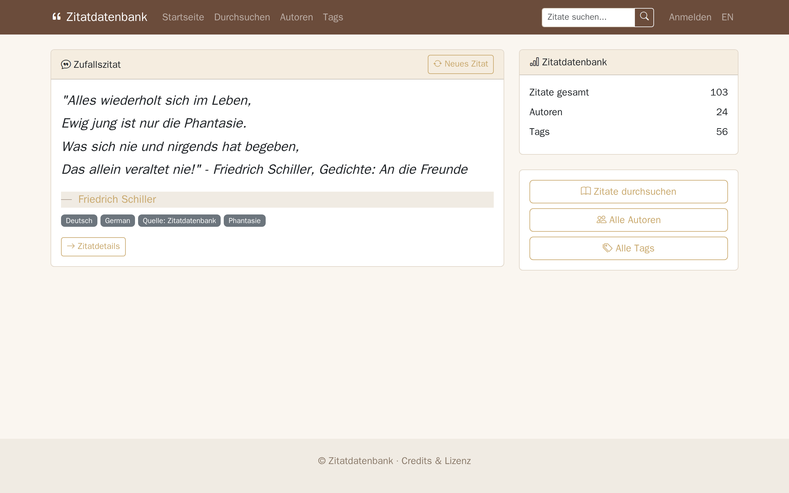
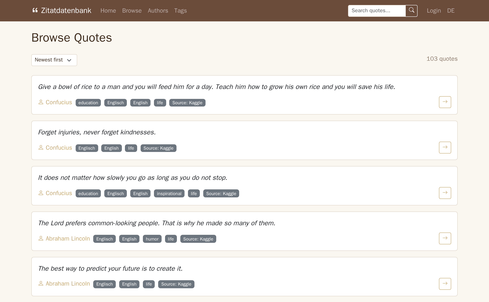
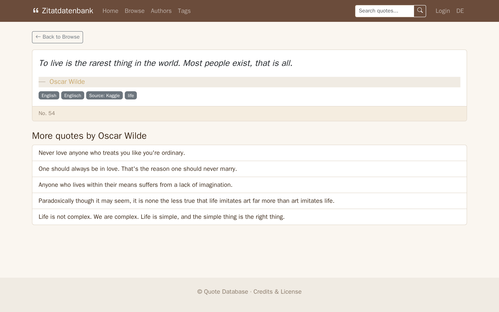
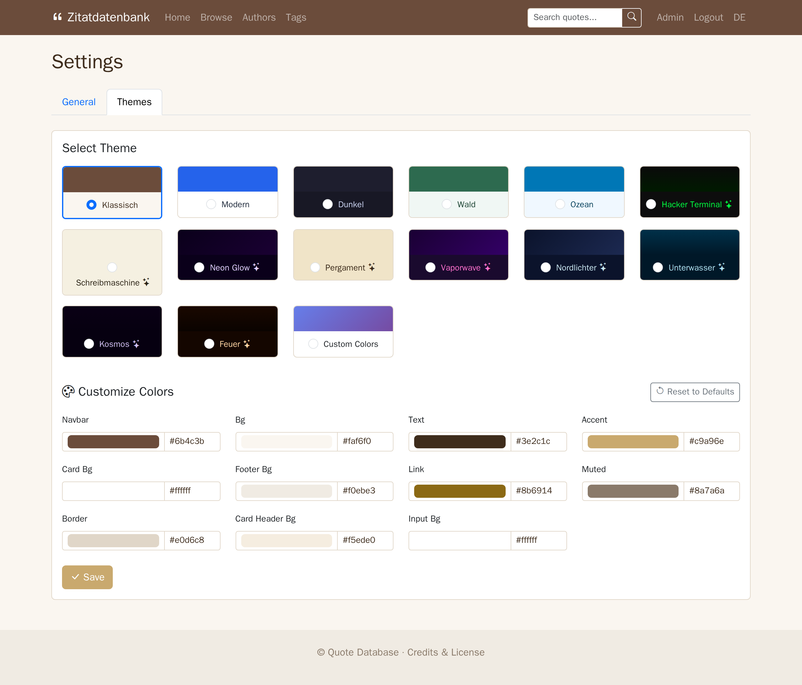
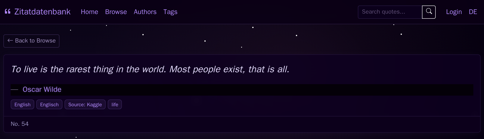
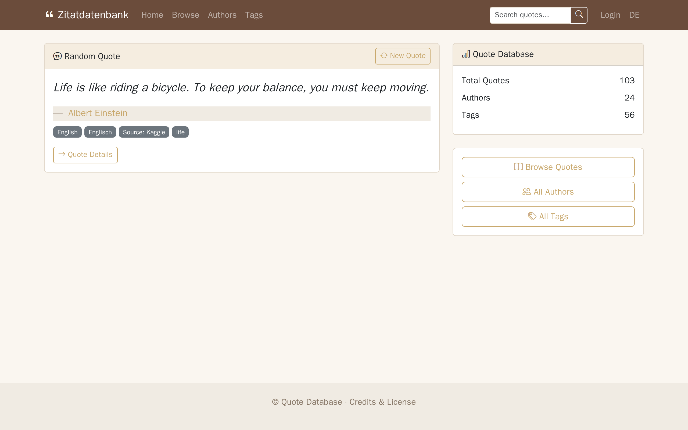

# Zitatdatenbank



Eine mehrsprachige (DE/EN) Webanwendung zum Durchsuchen, Suchen und Verwalten einer Sammlung von ~516.000 Zitaten (24.600 deutsche + 500.000 englische). Läuft als Docker-Stack (Flask + MariaDB); CI führt die Tests, `pip-audit` und die Screenshot-Tour als Render-Check aus.

---

## Funktionen

- **Durchsuchen** von Zitaten mit Paginierung, Filterung nach Autor/Tag und Sortierung
- **Volltextsuche** in Zitaten, Autoren und Tags
- **Autoren- & Tag-Listen** mit Zitatanzahl und alphabetischer Navigation
- **Zufallszitat** auf der Startseite mit Ein-Klick-Aktualisierung
- **Admin-Panel** mit Zitat-CRUD, Tag-Verwaltung, Einstellungen und Backup/Wiederherstellung
- **14 Themes** — 5 statische (Klassisch, Modern, Dunkel, Wald, Ozean) + 9 animierte (Hacker Terminal, Schreibmaschine, Neon Glow, Pergament, Vaporwave, Nordlichter, Unterwasser, Kosmos, Feuer), dazu „Eigene Farben“
- **Anpassung pro Theme** — alle 11 Farben und 2 Effektwerte (Tippgeschwindigkeit, Partikelanzahl) pro Theme im Admin-Bereich einstellbar
- **Tipp-Animation** bei animierten Themes mit konfigurierbarem Cursor und Geschwindigkeit
- **Partikeleffekte** — Blasen, Sterne, Funken usw. mit konfigurierbarer Anzahl
- **Zeilenumbruch-Darstellung** — `//` im Zitattext wird als Zeilenumbruch angezeigt
- **Zweisprachig** — Deutsch/Englisch-Oberfläche mit Ein-Klick-Sprachwechsel
- **REST-API** für Zitate mit Filterung, Suche und Paginierung

## Screenshots






Alle Seiten und alle 14 Themes: [Screenshot-Galerie](docs/screenshots/README.md) (englische Oberfläche, die Startseite auch auf Deutsch).

Die Bilder erzeugt die Screenshot-Tour (`e2e/docs/`, Playwright): Sie baut das Image, startet einen Wegwerf-Stack (Compose-Projekt `zitatdatenbank_docs`, nur `127.0.0.1:${PORT_BASE:-25600}`, ohne Bind-Mounts, also ohne `data/data.tar.gz`), importiert ~100 Beispielzitate aus `e2e/docs/fixtures/` und fotografiert jede Seite:

```bash
cd e2e && npm ci && npx playwright install chromium && cd ..
scripts/docs-screenshots.sh                  # schreibt docs/screenshots/*.png
PORT_BASE=25600 scripts/docs-screenshots.sh /tmp/shots   # anderer Port / Zielordner
```

Der Workflow **Docs screenshots** (Actions, manuell) liefert dieselben Bilder als Artefakt.

## Performance

Optimiert für 500.000+ Zitate mit:

- **Keyset-Paginierung (cursorbasiert)** — Seiten laden in konstanter Zeit, egal wie tief (Seite 26100 = 25ms, wie Seite 1)
- **In-Memory-Cache** (5 Min. TTL) für Statistiken, Theme, Tags, Einstellungen — eliminiert 15+ DB-Abfragen pro Request
- **FastPagination** — überspringt teure COUNT-Abfragen mit N+1-Fetch
- **FULLTEXT-Indizes** auf Text- und Autorspalten (MariaDB)
- **selectinload** für Tags — bündelt N+1 Tag-Abfragen in eine einzige IN-Abfrage
- **Gecachte Tag-Name→ID-Map** — Suche findet passende Tags in Mikrosekunden statt SQL-ILIKE-Scan

| Route | Antwortzeit |
|-------|-------------|
| Startseite | 7ms |
| Durchsuchen | 87ms |
| Durchsuchen tief (Seite 25000+) | 25ms |
| Autoren | 20ms |
| Tags | 3ms |
| Suche | 33–100ms |
| Zitatdetail | 16ms |

## Schnellstart mit Docker

Voraussetzung: [Git LFS](https://git-lfs.com). `data/data.tar.gz` liegt in Git LFS; ohne git-lfs enthält der Klon nur eine kleine Pointer-Datei, und der `web`-Container bricht beim Start mit einem entsprechenden Hinweis ab.

```bash
git lfs install && git lfs pull   # einmalig nach dem Klonen: holt data/data.tar.gz (~53 MB)
cp .env.example .env
# .env mit eigenen Werten bearbeiten (SECRET_KEY, Passwörter)

docker compose up -d
```

Die Datendateien (`data/data.tar.gz`) werden beim ersten Start automatisch entpackt. Die App importiert dann automatisch ~24.600 deutsche Zitate aus `zitate.sql` und ~500.000 englische Zitate aus `quotes.csv`, führt eine versionierte Datenbereinigung durch (Wiki-Markup, abgeschnittene Autoren, nicht-lateinische Schriftzeichen, Deduplizierung via CRC32-indiziertem Hashing) und erstellt einen Admin-Benutzer aus Umgebungsvariablen.

**HTTPS:** Session-Cookies sind `Secure`. Über reines HTTP funktionieren Anmeldung, Formulare (CSRF) und Sprachwechsel nur unter `http://localhost`; auf einem Server die App hinter einen HTTPS-Reverse-Proxy stellen.

**MariaDB-Upgrade bestehender Installationen:** Der `db`-Service setzt `MARIADB_AUTO_UPGRADE=1`, daher wird `mariadb-data/` beim ersten Start mit einer neueren Major-Version automatisch aktualisiert. Vorher einen geprüften Dump anlegen (`docker compose exec db mariadb-dump ...`) — ein Major-Upgrade lässt sich nicht zurückrollen.

## Entwicklung

```bash
pip install -r requirements.txt

# Tests ausführen
python3 -m pytest

# Lokal starten (SQLite unter instance/dev.db, Admin admin/admin)
cd app
export SECRET_KEY=dev-secret SQLALCHEMY_DATABASE_URI=sqlite:///dev.db
flask create-admin --username admin --password admin   # legt auch die Tabellen an
flask import-csv ../e2e/docs/fixtures/quotes-en.csv --default-tags "English,Englisch,Source: Kaggle"
flask run      # http://localhost:5000
```

`flask`-Befehle (auch `flask run`) legen nur die Tabellen an. Die Startsequenz (Admin aus `ADMIN_PASSWORD`, Auto-Import aus `/data`, Bereinigung, Tag-Migration, Suchindizes) läuft nur im Server (gunicorn im Docker-Image).

## CLI-Befehle

Im Ordner `app/` mit `flask …`, im Docker-Stack mit `docker compose exec web flask …`:

- `flask import-quotes <pfad>` — Zitate aus SQL-Dump importieren
- `flask import-csv <pfad> --default-tags "tag1,tag2"` — Zitate aus CSV importieren (Spalten: quote, author, category)
- `flask cleanup-quotes` — Wiki-Markup, abgeschnittene Autoren/Kategorien, nicht-lateinische Schriftzeichen und Duplikate bereinigen
- `flask create-admin --username X --password Y` — Admin-Benutzer erstellen

## Admin-Zugang

Zugangsdaten werden über die Umgebungsvariablen `ADMIN_USERNAME` und `ADMIN_PASSWORD` gesetzt (ohne `.env`-Wert setzt `docker-compose.yml` `admin`/`admin`). Der Benutzer wird nur angelegt, wenn er noch nicht existiert; ein späteres Ändern von `ADMIN_PASSWORD` ändert das Passwort nicht — dafür `flask create-admin --username <name> --password <neu>`. Das Admin-Panel ist unter `/admin` erreichbar.

## Themes

| Statisch | Animiert |
|----------|----------|
| Klassisch | Hacker Terminal |
| Modern | Schreibmaschine |
| Dunkel | Neon Glow |
| Wald | Pergament |
| Ozean | Vaporwave |
| | Nordlichter |
| | Unterwasser |
| | Kosmos |
| | Feuer |

Dazu kommt „Eigene Farben“ (frei wählbare Farben auf Basis von Klassisch). Alle Theme-Farben und -Effekte sind pro Theme über die Admin-Einstellungen anpassbar. Animierte Themes beinhalten Tipp-Animationen und Partikeleffekte (Blasen, Sterne, Funken) mit konfigurierbarer Geschwindigkeit und Anzahl.

## Sicherheit

- **CSP** mit Nonce-basierter script-src, `frame-ancestors 'none'`, `object-src 'none'`
- **X-Frame-Options: DENY**, **X-Content-Type-Options: nosniff**
- **CSRF**-Schutz auf allen Formularen (Flask-WTF)
- **Rate-Limiting** bei Login (10/Min.), Suche (30/Min.) und API-Endpunkten (30–60/Min.) mit `X-RateLimit-*`-Headern
- **Session-Sicherheit** — HttpOnly, SameSite=Lax, Secure-Cookies, 8h Timeout
- **Eingabevalidierung** — numerische Grenzen, Hex-Farb-Regex für alle Theme-Overrides, Effektwert-Validierung, Dateinamen-Whitelist, Seitenzahl-Begrenzung, FULLTEXT-Operator-Bereinigung, LIKE-Wildcard-Escaping
- **Open-Redirect-Schutz** beim Login-`next`-Parameter (nur Pfade) und `Referer`-basierten Weiterleitungen (Same-Host-Prüfung)
- **Sichere Backups** — schließt App-State-Tabellen aus, Tar lehnt Symlinks ab, Restore setzt Cleanup-/Migrationsstatus zurück
- **Datenintegrität** — `ON DELETE CASCADE` auf Foreign Keys, Savepoint-basierte `IntegrityError`-Behandlung bei gleichzeitigen Schreibvorgängen
- **Transaktionssicherheit** — `begin_nested()`-Savepoints verhindern, dass Tag-Race-Conditions umgebende Transaktionen zurückrollen

## API

Alle Endpunkte liefern JSON und sind rate-limitiert. Rate-Limit-Header (`X-RateLimit-Limit`, `X-RateLimit-Remaining`, `X-RateLimit-Reset`) sind in jeder Antwort enthalten.

### `GET /api/random`

Gibt ein zufälliges Zitat zurück (30 Anfragen/Minute).

```json
{"id": 42, "text": "Der einzige Weg...", "author": "Albert Einstein", "tags": ["Deutsch", "Philosophie"]}
```

### `GET /api/quotes`

Zitate durchsuchen und suchen mit Paginierung (30 Anfragen/Minute).

| Parameter | Beschreibung | Standard |
|-----------|-------------|----------|
| `page` | Seitennummer | 1 |
| `per_page` | Ergebnisse pro Seite (1–100) | 20 |
| `author` | Nach exaktem Autorennamen filtern | — |
| `tag` | Nach Tag-Name filtern | — |
| `q` | Volltextsuche in Text und Autor | — |

```json
{"quotes": [...], "page": 1, "per_page": 20, "has_next": true, "has_prev": false}
```

### `GET /api/quotes/<id>`

Gibt ein einzelnes Zitat nach ID zurück (60 Anfragen/Minute).

```json
{"id": 42, "text": "Der einzige Weg...", "author": "Albert Einstein", "tags": ["Deutsch", "Philosophie"]}
```

### `GET /health`

Healthcheck (nicht rate-limitiert): `200 {"status": "ok", "checks": {"database": "ok"}}`, bei Datenbankfehler `503`.

---

# Zitatdatenbank (English)



A multilingual (DE/EN) web application for browsing, searching, and managing a collection of ~516,000 quotes (24.6k German + 500k English). Runs as a Docker stack (Flask + MariaDB); CI runs the tests, `pip-audit` and the screenshot tour as a render check.

## Features

- **Browse** quotes with pagination, filtering by author/tag, and sorting
- **Search** full-text across quotes, authors, and tags
- **Author & Tag** listings with quote counts and alphabetical navigation
- **Random Quote** on the landing page with one-click refresh
- **Admin Panel** with quote CRUD, tag management, settings, and backup/restore
- **14 Themes** - 5 static (Klassisch, Modern, Dunkel, Wald, Ozean) + 9 animated (Hacker Terminal, Schreibmaschine, Neon Glow, Pergament, Vaporwave, Nordlichter, Unterwasser, Kosmos, Feuer), plus "Custom Colors"
- **Per-theme customization** - all 11 colors and 2 effect values (typing speed, particle count) editable per theme in admin settings
- **Typing animation** on animated themes with per-theme cursor styles and configurable speed
- **Particle effects** - bubbles, stars, embers etc. with configurable count
- **Line break rendering** - `//` in quote text displayed as proper line breaks
- **Bilingual** German/English UI with one-click language switching
- **REST API** for quotes with filtering, search, and pagination

## Screenshots


Every page and all 14 themes: [screenshot gallery](docs/screenshots/README.md).

The images come from the screenshot tour (`e2e/docs/`, Playwright). It builds the image, starts a throwaway stack (compose project `zitatdatenbank_docs`, `127.0.0.1:${PORT_BASE:-25600}` only, no bind mounts, so `data/data.tar.gz` is never used), imports ~100 sample quotes from `e2e/docs/fixtures/` and photographs every page:

```bash
cd e2e && npm ci && npx playwright install chromium && cd ..
scripts/docs-screenshots.sh                  # writes docs/screenshots/*.png
PORT_BASE=25600 scripts/docs-screenshots.sh /tmp/shots   # other port / output dir
```

The **Docs screenshots** workflow (Actions, manual) returns the same images as an artifact.

## Performance

Optimized for 500k+ quotes with:

- **Keyset (cursor-based) pagination** — browse pages load in constant time at any depth (page 26100 = 25ms, same as page 1)
- **In-memory caching** (5-min TTL) for stats, theme, tags, settings — eliminates 15+ DB queries per request
- **FastPagination** — skips expensive COUNT queries using N+1 fetch
- **FULLTEXT indexes** on text and author columns (MariaDB)
- **selectinload** for tags — batches N+1 tag queries into a single IN query
- **Cached tag name→ID map** — search finds matching tags in microseconds instead of SQL ILIKE scan

| Route | Response Time |
|-------|--------------|
| Index | 7ms |
| Browse | 87ms |
| Browse deep (page 25000+) | 25ms |
| Authors | 20ms |
| Tags | 3ms |
| Search | 33–100ms |
| Quote detail | 16ms |

## Quick Start with Docker

Requires [Git LFS](https://git-lfs.com): `data/data.tar.gz` is stored in Git LFS. Without git-lfs the clone only contains a small pointer file, and the `web` container exits on startup with a message saying so.

```bash
git lfs install && git lfs pull   # once after cloning: fetches data/data.tar.gz (~53 MB)
cp .env.example .env
# Edit .env with your values (SECRET_KEY, passwords)

docker compose up -d
```

The data files (`data/data.tar.gz`) are extracted automatically on first startup. The app then auto-imports ~24.6k German quotes from `zitate.sql` and ~500k English quotes from `quotes.csv`, runs versioned data cleanup (wiki markup, truncated authors, non-Latin scripts, deduplication via CRC32-indexed hashing), and creates an admin user from environment variables.

**HTTPS:** session cookies are `Secure`. Over plain HTTP, login, forms (CSRF) and the language switch only work on `http://localhost`; on a server, put the app behind an HTTPS reverse proxy.

**Upgrading an existing install to a newer MariaDB major:** the `db` service sets `MARIADB_AUTO_UPGRADE=1`, so the container upgrades `mariadb-data/` in place on its first start. Take a verified dump first (`docker compose exec db mariadb-dump ...`) — a major-version upgrade cannot be rolled back.

## Development

```bash
pip install -r requirements.txt

# Run tests
python3 -m pytest

# Run locally (SQLite in instance/dev.db, admin admin/admin)
cd app
export SECRET_KEY=dev-secret SQLALCHEMY_DATABASE_URI=sqlite:///dev.db
flask create-admin --username admin --password admin   # also creates the tables
flask import-csv ../e2e/docs/fixtures/quotes-en.csv --default-tags "English,Englisch,Source: Kaggle"
flask run      # http://localhost:5000
```

`flask` commands (`flask run` too) only create the tables. The startup sequence (admin from `ADMIN_PASSWORD`, auto-import from `/data`, cleanup, tag migration, search indexes) runs only in the server (gunicorn in the Docker image).

## CLI Commands

Run them in `app/` as `flask …`, or in the Docker stack as `docker compose exec web flask …`:

- `flask import-quotes <path>` — Import quotes from SQL dump
- `flask import-csv <path> --default-tags "tag1,tag2"` — Import quotes from CSV (columns: quote, author, category)
- `flask cleanup-quotes` — Fix wiki markup, truncated authors/categories, non-Latin scripts, deduplication
- `flask create-admin --username X --password Y` — Create admin user

## Admin Access

Credentials are set via the `ADMIN_USERNAME` and `ADMIN_PASSWORD` environment variables (without a `.env` value, `docker-compose.yml` uses `admin`/`admin`). The user is only created if it does not exist yet; changing `ADMIN_PASSWORD` later does not change the password - use `flask create-admin --username <name> --password <new>`. Access the admin panel at `/admin`.

## Themes

| Static | Animated |
|--------|----------|
| Klassisch | Hacker Terminal |
| Modern | Schreibmaschine |
| Dunkel | Neon Glow |
| Wald | Pergament |
| Ozean | Vaporwave |
| | Nordlichter |
| | Unterwasser |
| | Kosmos |
| | Feuer |

Plus "Custom Colors" (free colors on top of Klassisch). All theme colors and effects are customizable per-theme through the admin settings UI. Animated themes include typing animations and particle effects (bubbles, stars, embers) with configurable speed and count.

## Security

- **CSP** with nonce-based script-src, `frame-ancestors 'none'`, `object-src 'none'`
- **X-Frame-Options: DENY**, **X-Content-Type-Options: nosniff**
- **CSRF** protection on all forms (Flask-WTF)
- **Rate limiting** on login (10/min), search (30/min), and API endpoints (30–60/min) with `X-RateLimit-*` headers
- **Session security** — HttpOnly, SameSite=Lax, Secure cookies, 8h timeout
- **Input validation** — numeric bounds, hex color regex on all theme overrides, effect value int validation, filename whitelist, page clamping, FULLTEXT operator sanitization, LIKE wildcard escaping
- **Open redirect prevention** on login `next` parameter (path-only) and `Referer`-based redirects (same-host check)
- **Safe backups** — excludes app state tables, tar rejects symlinks, restore resets cleanup/migration state
- **Data integrity** — `ON DELETE CASCADE` on foreign keys, savepoint-based `IntegrityError` handling on concurrent writes
- **Transaction safety** — `begin_nested()` savepoints prevent tag race conditions from rolling back enclosing transactions

## API

All endpoints return JSON and are rate-limited. Rate limit headers (`X-RateLimit-Limit`, `X-RateLimit-Remaining`, `X-RateLimit-Reset`) are included in every response.

### `GET /api/random`

Returns a random quote (30 requests/minute).

```json
{"id": 42, "text": "The only way...", "author": "Albert Einstein", "tags": ["Deutsch", "Philosophie"]}
```

### `GET /api/quotes`

Browse and search quotes with pagination (30 requests/minute).

| Parameter | Description | Default |
|-----------|-------------|---------|
| `page` | Page number | 1 |
| `per_page` | Results per page (1–100) | 20 |
| `author` | Filter by exact author name | — |
| `tag` | Filter by tag name | — |
| `q` | Full-text search in text and author | — |

```json
{"quotes": [...], "page": 1, "per_page": 20, "has_next": true, "has_prev": false}
```

### `GET /api/quotes/<id>`

Returns a single quote by ID (60 requests/minute).

```json
{"id": 42, "text": "The only way...", "author": "Albert Einstein", "tags": ["Deutsch", "Philosophie"]}
```

### `GET /health`

Health check (not rate-limited): `200 {"status": "ok", "checks": {"database": "ok"}}`, `503` when the database is unreachable.
